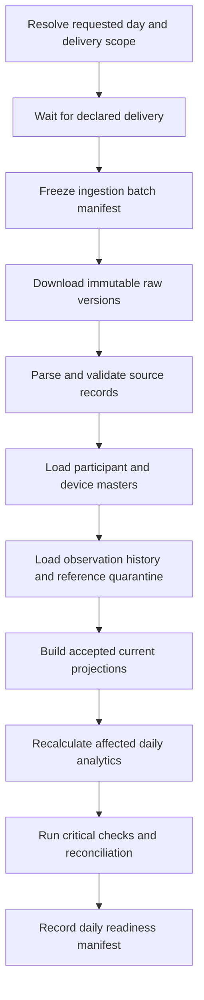
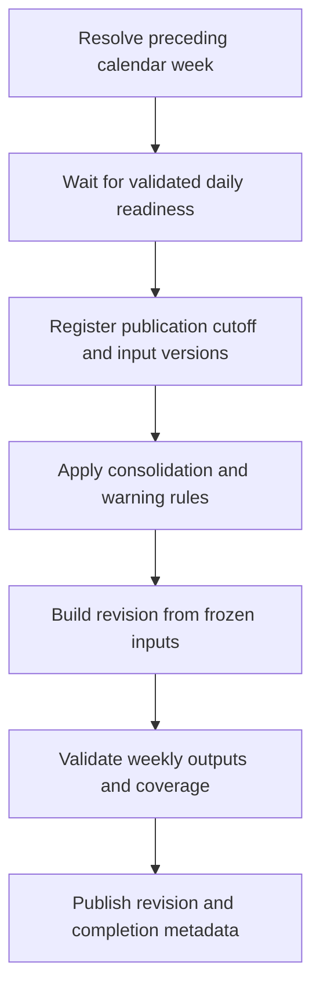

# Airflow Orchestration Design

Status: orchestration design; local runtime configuration is provided in compose.yaml. Daily and weekly DAGs remain unimplemented. Existing delivery, quality, and publication policies remain authoritative.

## Local Runtime

Use Linux containers through Docker Compose, PostgreSQL for Airflow metadata, and LocalExecutor for this single-host exercise. LocalExecutor runs independent task processes, so it does not remove DuckDB's cross-process access restrictions. Use one shared persistent analytical volume and the duckdb_access pool with one slot for every task opening that database, including readers that might overlap a writer. Separate source I/O tasks can run concurrently.

The local image selects Airflow 3.1.7 with Python 3.12 and compatible providers from its official constraints. requirements.txt pins runtime packages; requirements-dbt.txt declares a separate dbt environment. See the [Docker quick start](docker_quickstart.md). An Airflow 3 deployment needs the API server, scheduler, DAG processor, metadata database, and initialization step; add a triggerer if deferrable sensors are selected. Use reschedule sensors initially to avoid a mandatory triggerer. Dependencies are installed during image construction rather than container startup.

Runtime data, logs, and database volumes must be outside OneDrive synchronization. Keep credentials in Airflow connections/environment configuration outside Git. Treat the Compose deployment as local development, not a production deployment.

## Daily DAG: wearable_daily_pipeline

Process the preceding local calendar day and newly accepted correction batches. The daily execution time is still configurable and has not been approved. Use an explicit trigger timetable and derive the requested date from its scheduled trigger time, never the task's current wall clock. A proposed daily trigger timetable must not shift the study day to a non-midnight cron interval.

Daily readiness records target_date, accepted batch/version identifiers, validation status, and rule/code versions. It is published only after successful checks; warning counts and coverage remain visible. Source absence is not an empty delta. An explicitly declared empty delivery is valid. File preparation can use task groups or dynamic mapping by source/file without passing records through XCom.

All DuckDB phases acquire duckdb_access and close their connections before releasing it. Treat each phase as an idempotent unit with per-model checkpoints. Reference resolution and late observations add original dates to affected_participant_dates, so daily processing is not limited to the requested day.

## Weekly DAG: wearable_weekly_biostatistics

Use Monday 03:00 in America/Bogota with a trigger timetable corresponding to cron 0 3 * * 1. Derive the preceding Monday-to-Monday midnight event period from the scheduled trigger date. Airflow cron data intervals at 03:00 are not the clinical event boundaries. Persist the business scope at run registration; delays and retries never move it.

Wait for the Sunday daily readiness record by business target_date, not equality between daily and weekly logical dates. For the first publication, also verify readiness for all required study days in scope, allowing explicit out-of-study exclusions. Do not publish a week merely because Sunday's task succeeded while required earlier deliveries are absent. A daily failure or missing delivery blocks weekly publication.

The weekly DAG does not perform a second independent ingestion. The daily DAG owns delivery ingestion. A readiness sensor checks a persistent manifest outside the shared DuckDB file, or briefly accesses DuckDB through the same access pool; it never waits while holding an open database connection. No publication task is scheduled as an independent Monday cron job without this dependency.

Freeze correction_cutoff_at and accepted input versions atomically under duckdb_access after prerequisites pass. Build the publication from historical versions identified by that manifest, not mutable current tables. Later daily work may update current state without altering the frozen publication. Corrections accepted after freezing are included through a separately requested revision.

## Control Records and Retries

Persist delivery manifests, per-model processing state, daily readiness manifests, and publication manifests independently of Airflow's task logs. Airflow metadata is orchestration state, not the business audit trail. XCom contains only small identifiers, paths, scope, and summary counts; raw data and large arrays remain in storage.

Initial proposed defaults: poll availability every five minutes in reschedule mode; retry transient processing failures up to three times with a five-minute initial delay and exponential backoff. These are configurable design defaults, not producer SLAs. Choose a finite sensor timeout before deployment; reaching it marks the run unsuccessful, keeps the business publication pending, and never publishes stale data. Retry/clear the same business scope when delivery arrives. External notifications require an explicitly configured destination.

Use max_active_runs=1 per DAG initially, plus the shared database access pool across DAGs. This simplifies local operation but may queue newer scopes behind a delayed run. A future concurrency change must preserve delivery ordering and version precedence. Do not use depends_on_past to establish weekly readiness.

Use catchup=False for the initial demonstration. Replay the January-February 2026 baseline through explicit manual scopes and a fixed bootstrap manifest; the source does not currently provide a live daily delta feed. Fixture-generated deltas must be labeled synthetic. Backfills accept explicit target_date or week_start, and optionally publication revision, validate them, and reuse stable input versions. No scope is computed from datetime.now during retries.

## Implementation Sequence and Acceptance

1. Validate Docker Engine/Compose access and select pinned images and provider/dbt versions.
2. Configure metadata persistence, analytical storage, connections, and the shared access pool.
3. Implement manifest/readiness interfaces and standalone loading commands.
4. Implement and parse-test the daily DAG against the bootstrap dataset and synthetic delta fixtures.
5. Implement weekly dependency, atomic input freeze, and versioned publication.
6. Verify missing delivery, declared empty delta, delayed Sunday data, critical validation failure, conflicting rows, retry after commit, Monday-to-Tuesday delay, and late publication revisions.

Still required before scheduling: the daily trigger time, the expected-delivery manifest specification, sensor timeout, validated runtime pins, and concrete processing commands. The public baseline inventory must not be mistaken for a newly arrived Sunday delta.

References: [Airflow scheduling](https://airflow.apache.org/docs/apache-airflow/stable/authoring-and-scheduling/cron.html), [sensors](https://airflow.apache.org/docs/apache-airflow/stable/core-concepts/sensors.html), [pools](https://airflow.apache.org/docs/apache-airflow/stable/administration-and-deployment/pools.html), [LocalExecutor](https://airflow.apache.org/docs/apache-airflow/stable/core-concepts/executor/local.html).
