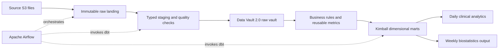

# Architecture outline

Status: platform and integration direction selected; implementation pending. See the [decision records](README.md) and [quality policy](data_quality_policy.md) for accepted contracts and assumptions.

## Target flow

## Component responsibilities

| Component | Responsibility | Status |
| --- | --- | --- |
| Python | Retrieve source files, inventory inputs, profile data, load staging | Planned |
| Airflow | Schedule daily and weekly workflows, retries, dependencies, and backfills | Local services verified; processing DAGs pending |
| dbt Core | SQL transformations, model dependencies, data tests, and generated documentation | Installed in an isolated environment; models pending |
| Docker Compose | Reproducible local development environment | Configuration and startup verified |
| DuckDB with dbt-duckdb | Execute dbt models and serve analytical tables | Dependencies installed; analytical models pending |
| PostgreSQL | Store Airflow orchestration state separately from analytical data | Metadata database initialized and verified |
| CI | Validate code, dbt models, and reproducibility | Planned |

## Data Vault Integration

Implement participant and device hubs, their assignment link, and descriptive satellites. Use separate participant-attached observation satellites for steps and heart rate, and session/response hubs and links for sleep and wellness. See [ADR 003](decisions/003_data_vault_model.md) for grains, enrollment context, versioning, and device attribution limits.

The [table catalog](table_catalog.md) defines proposed control, raw/staging, vault, current-state, dimensional, daily, and revision-specific publication relations before loading implementation.

Minute observations use participant and UTC timestamp discriminators rather than one hub per reading. Raw and vault history preserve source evidence; current projections apply accepted quality rules and authoritative delta precedence.

The additional tables and joins are an accepted trade-off for auditability and source history. Describe this as Data Vault 2.0-aligned unless broader methodology requirements are met. Assess any automation package against the selected DuckDB adapter before adoption.

## Local Execution and Cloud Target

Use immutable raw storage and delta delivery manifests. Current facts and aggregates use transactional delete/insert; vault history preserves versions. All independent DuckDB writer processes share one Airflow pool slot. File preparation can run in parallel. See [ADR 001](decisions/001_local_platform.md) and [ADR 002](decisions/002_delta_contract.md).

Development environments are separate database files rebuilt from manifests or created through consistent physical copies. Snowflake remains a cloud target; Zero-Copy Clone and warehouse isolation are not simulated by these copies.

Biostatistics publications freeze an input manifest and correction cutoff, preserve reported sleep metrics, and consolidate unresolved semantic issues with warnings. Discordant post-boundary awake stages are excluded only from consolidated output. Late corrections create publication revisions. The [quality policy](data_quality_policy.md) defines this lifecycle.

## Kimball evaluation

Proposed conformed dimensions: participant, device, and date. Candidate facts: minute activity/heart rate, sleep sessions, daily wellness, and participant-day summaries. Define grain and dimension history before implementing joins.

Daily and weekly outputs should derive from shared rules. Document week boundaries, partial-week coverage, missing values, and aggregation denominators. Preserve the required `gold_participant_devices` output with one row per participant.

## Reliability and learning checkpoints

1. Inventory and profile the data; capture evidence before defining corrections.
2. Configure the selected local database and verify adapter/runtime compatibility.
3. Translate the accepted vault design into physical models and configure the accepted [publication schedule](publication_schedule.md), including source-availability checks.
4. Implement one source end to end with quality checks, lineage, and idempotent reruns.
5. Extend the pipeline, add daily/weekly Airflow schedules, and verify backfills.
6. Validate analytical results and package the reproducible local environment.

Each checkpoint should produce working code, a short explanation, and observable validation. Version pins and runnable configuration will be added after compatibility checks; empty folders are placeholders, not working services.

## References

- [dbt and Airflow integration](https://www.getdbt.com/blog/dbt-airflow)
- [AutomateDV Data Vault tutorial](https://automate-dv.readthedocs.io/en/latest/tutorial/)
