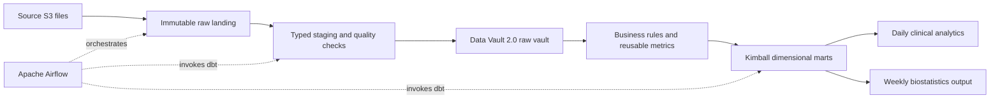

# Architecture outline

Status: proposal for evaluation, not an implemented architecture.

## Target flow

## Component responsibilities

| Component | Responsibility | Status |
| --- | --- | --- |
| Python | Retrieve source files, inventory inputs, profile data, load staging | Planned |
| Airflow | Schedule daily and weekly workflows, retries, dependencies, and backfills | Required |
| dbt Core | SQL transformations, model dependencies, data tests, and generated documentation | Required |
| Docker Compose | Reproducible local development environment | Planned |
| Analytical database | Execute dbt models and serve analytical tables | To select |
| Airflow metadata database | Store orchestration state separately from analytical data | To configure |
| CI | Validate code, dbt models, and reproducibility | Planned |

## Data Vault 2.0 evaluation

Evaluate participant and device hubs, their relationship link, and descriptive satellites. Define business keys, record source, load timestamps, deterministic hashing, historization, and replay behavior explicitly.

Choose the grain of minute observations, sleep sessions, and surveys after profiling. High-volume observations need a deliberate design; they should not automatically become one new hub per reading.

Compare the auditability and source-change isolation of a vault against its extra tables, joins, and development effort for a 50-participant study. Describe this as a Data Vault 2.0-aligned implementation unless broader methodology requirements are actually met. Assess an automation package only after selecting a compatible database and dbt adapter.

## Kimball evaluation

Proposed conformed dimensions: participant, device, and date. Candidate facts: minute activity/heart rate, sleep sessions, daily wellness, and participant-day summaries. Define grain and dimension history before implementing joins.

Daily and weekly outputs should derive from shared rules. Document week boundaries, partial-week coverage, missing values, and aggregation denominators. Preserve the required `gold_participant_devices` output with one row per participant.

## Reliability and learning checkpoints

1. Inventory and profile the data; capture evidence before defining corrections.
2. Select the database and explain local/cloud alternatives, cost, and concurrency.
3. Record the vault and dimensional modeling decisions with example records.
4. Implement one source end to end with quality checks, lineage, and idempotent reruns.
5. Extend the pipeline, add daily/weekly Airflow schedules, and verify backfills.
6. Validate analytical results and package the reproducible local environment.

Each checkpoint should produce working code, a short explanation, and observable validation. Version pins and runnable configuration will be added after compatibility checks; empty folders are placeholders, not working services.

## References

- [dbt and Airflow integration](https://www.getdbt.com/blog/dbt-airflow)
- [AutomateDV Data Vault tutorial](https://automate-dv.readthedocs.io/en/latest/tutorial/)
